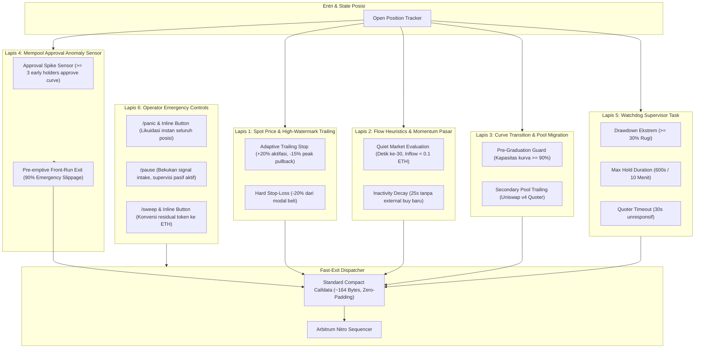
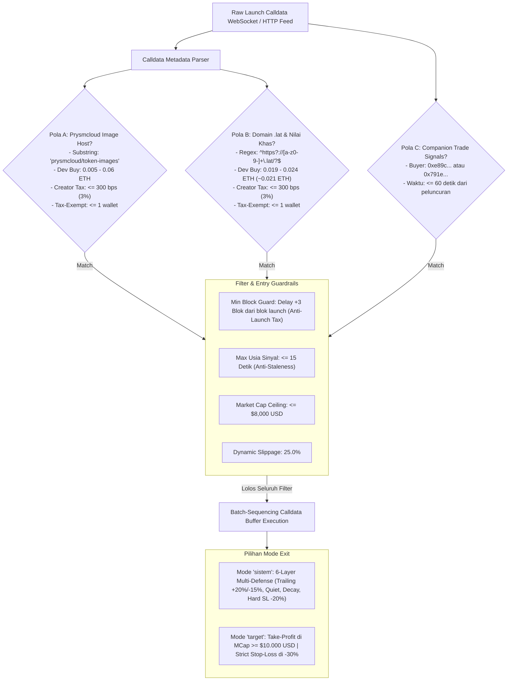

# HIGH-FREQUENCY ON-CHAIN SIGNAL REPLICATOR & BATCH-SEQUENCING ENGINE (RUST + TELEGRAM UI)

Sistem perdagangan otomatis berkinerja tinggi (**Automated Quantitative Execution Engine**) yang dibangun menggunakan bahasa pemrograman **Rust** khusus untuk jaringan EVM Layer-2 **Arbitrum Nitro / Robinhood Chain (Chain ID: 4663, Native Asset: ETH)**.

Dilengkapi dengan antarmuka kendali penuh berbasis **Telegram Bot (Teloxide Interactive UI & Inline Keyboards)** untuk pemantauan, konfigurasi parameter, eksekusi darurat satu-klik, dan kontrol posisi real-time dari perangkat seluler.

---

## 🛡️ ARSITEKTUR RISK MANAGEMENT BERLAPIS (6-LAYER DEFENSIVE EXECUTION PIPELINE)

Sistem mengimplementasikan sistem mitigasi risiko dan siklus penutupan posisi (*Position Exit & Risk Mitigation Architecture*) berlapis 6 tingkat (**6-Layer Defense**) yang dievaluasi secara non-blocking dalam hitungan **nanodetik (< 100 ns)**:



### Rincian 6 Lapis Pertahanan:

1. **Lapis 1: Aturan Harga Spot & High-Watermark Trailing (`src/risk/price_rules.rs`)**
   - **Adaptive High-Watermark Trailing:** Terpicu otomatis saat harga spot posisi mencapai laba $\ge +20\%$ (`TRAIL_ACTIVATE = 20.0%`). Setelah aktif, sistem mencatat titik puncak tertinggi (*High-Water Mark*). Jika harga terkoreksi sebesar **$15\%$ dari titik puncak** (`TRAIL_DIST = 15.0%`), posisi seketika dilikuidasi untuk mengunci margin laba.
   - **Hard Stop-Loss Otomatis:** Jika harga spot kurva menyentuh **$-20\%$** (`STOP_LOSS = 20.0%`) dari harga beli awal, posisi dilikuidasi seketika.

2. **Lapis 2: Heuristik Aliran Dana & Momentum Pasar (`src/risk/flow_rules.rs`)**
   - **Quiet Market Evaluation (`sepi`):** Dievaluasi tepat pada detik ke-**30** setelah transaksi entri terkonfirmasi (`QUIET_EXIT_SECONDS = 30`). Jika total dana masuk dari pihak ketiga **$< 0.1 \text{ ETH}$**, sistem melikuidasi posisi (`ExitReason::QuietMarket`).
   - **Inactivity Decay (`idle`):** Jika tidak ada aktivitas beli eksternal baru selama **25 detik berturut-turut** (`IDLE_TIMEOUT_SECONDS = 25`), posisi segera ditutup (`ExitReason::InactivityDecay`) sebelum likuiditas kurva menyusut.

3. **Lapis 3: Transisi Kelulusan Kurva & Pool Migration (`src/risk/migration_rules.rs`)**
   - **Pre-Graduation Guard (`pre_grad`):** Jika kapasitas kurva bonding mencapai **$\ge 90\%$** (`GRAD_GUARD = 90.0%`), sistem melikuidasi posisi lebih awal sebelum transisi cliff likuiditas ke Uniswap pool sekunder.
   - **Secondary Pool Trailing (`pool_exit`):** Posisi yang bertransisi ke pool Uniswap v4 dikawal oleh kuotasi quoter sekunder dengan trailing stop dan stop-loss adaptif.

4. **Lapis 4: Mempool Approval Anomaly Sensor (`src/risk/anomaly_sensor.rs`)**
   - **Sensor Anomali Persetujuan:** Memindai mempool feed secara real-time. Jika terdeteksi **$\ge 3$ holder awal** menyetujui transaksi *Approve* token sasaran ke router kurva dalam jendela waktu singkat (indikasi *pre-dump*), sistem memicu likuidasi darurat mendahului pasar (*pre-emptive front-run exit*) dengan toleransi *slippage* **$90\%$** dan gas priority fee agresif.

5. **Lapis 5: Watchdog Supervisor Task (`src/risk/watchdog.rs`)**
   - Berjalan pada background task terisolasi dengan siklus presisi 5 detik (`tokio::time::interval(5s)`):
     - **Watchdog Drawdown:** Likuidasi seketika tanpa syarat jika posisi mengalami kerugian $\ge 30\%$ (`ExitReason::WatchdogDrawdown`).
     - **Watchdog Max Hold:** Likuidasi otomatis jika posisi tertahan lebih dari **600 detik (10 menit)** (`ExitReason::WatchdogTimeout`).
     - **Pool Quote Timeout:** Likuidasi jika quoter harga pool sekunder gagal merespons selama **30 detik berturut-turut** (`ExitReason::PoolQuoteTimeout`).

6. **Lapis 6: Kontrol Operator & Penutupan Darurat Manual (`src/telegram/emergency_controls.rs` & `src/telegram.rs`)**
   - **Command `/panic` & Tombol Inline `🚨 Panic Sell All`:** Menutup seluruh posisi terbuka seketika dalam beberapa milidetik dan membekukan intake sinyal baru.
   - **Command `/pause`:** Membekukan intake sinyal tanpa menutup posisi yang sedang berjalan (mode supervisi pasif).
   - **Command `/sweep` & Tombol Inline `🧹 Sweep Assets`:** Melikuidasi seluruh saldo residual token di dompet master dan akun satelit kembali menjadi Native ETH.

---

---

## 🔬 STRATEGI MANDIRI: "SERI PRYSM" (FAST-PATH PATTERN EVALUATOR)

Sistem mengintegrasikan modul strategi perdagangan otonom bernama **"Seri Prysm" (`src/models/prysm.rs`)**. Modul ini beroperasi secara independen tanpa bergantung pada daftar akun pantauan (*watchlist*), memindai metadata calldata peluncuran token secara paralel, dan mengeksekusi posisi seketika ketika sidik jari metadata cocok dengan pola operator Seri Prysm:



### 🔹 3 Pola Sidik Jari Metadata:
1. **Pola A (Prysmcloud Image Storage):**
   - Substring URL Gambar: `"prysmcloud/token-images"` (hosting vercel-storage / IPFS).
   - Alokasi Developer Buy: Rentang `0.005 ETH` hingga `0.06 ETH`.
   - Creator Tax: $\le 300\text{ bps}$ ($3\%$).
   - Tax-Exempt Wallets: $\le 1$ alamat selain developer (proteksi *anti-bundle*).
2. **Pola B (Domain `.lat` & Karakteristik Dev Buy ~0.021 ETH):**
   - Pola Regex Domain Website: `^https?://[a-z0-9-]+\.lat/?$`
   - Dev Buy Spesifik: Rentang ketat `0.019 ETH` hingga `0.024 ETH` (karakteristik khas operator $\approx 0.021\text{ ETH}$).
   - Creator Tax: $\le 300\text{ bps}$ ($3\%$), Tax-Exempt Wallets $\le 1$.
3. **Pola C (Companion Trade Signals):**
   - Sinyal beli dari dompet rekanan teridentifikasi:
     - `0xe89c3d903e84aab1c6327c794ea8e749b60a347c`
     - `0x791ef6e64a3fb267502ceb950b57a81671974065`
   - Terjadi dalam jendela waktu $\le 60\text{ detik}$ sejak blok peluncuran token.

### 🛡️ Guardrails & Mode Keluar (Exit Modes):
- **Min Block Guard (+3 Blok):** Order secara deterministik diantrikan (*queued*) dan hanya disiarkan mulai dari Blok $+3$ setelah peluncuran untuk menghindari *launch tax* blok 0.
- **Max Usia Sinyal:** $\le 15\text{ detik}$ (menolak sinyal usang/stale).
- **Market Cap Ceiling:** $\le \$8.000\text{ USD}$ saat pemicuan order.
- **Dua Pilihan Mode Exit:**
  - `sistem`: Memakai siklus proteksi 6 lapis standar (Trailing profit +20% act, -15% peak, Quiet market 30s <0.1 ETH, Inactivity decay 25s, Hard SL -20%).
  - `target`: Take-profit otomatis saat kapitalisasi pasar menyentuh **$\ge \$10.000\text{ USD}$** atau proteksi *strict stop-loss* pada **$-30\%$**.

---

## ⚡ RINGKASAN OPTIMASI PERFORMA & LATENSI (< 100 µs TARGET)

Pengujian micro-benchmark nyata dilakukan menggunakan harness **Criterion**:

| Komponen Pipeline | Modul Rust | Metode Optimasi | Latensi Eksekusi (Criterion) |
| :--- | :--- | :--- | :--- |
| **Pola A Evaluation** | `src/models/prysm.rs` | Zero-Allocation Substring Match | **10.08 ns** (0.010 µs) |
| **Pola B Evaluation** | `src/models/prysm.rs` | Pre-compiled Static Regex Matching | **39.27 ns** (0.039 µs) |
| **Pola C Evaluation** | `src/models/prysm.rs` | Fast Address Lookups & Temporal Delta | **8.05 ns** (0.008 µs) |
| **Ingesti JSON Feed** | `src/stream.rs` | Zero-Copy Byte Slice Scan (`ZeroCopyTxParser`) | **312.47 ns** (0.312 µs) |
| **Signature Matching** | `src/stream.rs` | 1-Cycle Integer Bitwise Match (`fast_selectors`) | **832.22 ps** (0.0008 µs) |
| **Nonce Allocation** | `src/wallet.rs` | Lock-Free In-Memory Atomic Nonce (`AtomicU64`) | **1.52 ns** (0.0015 µs) |
| **Calldata Buffer Assembly** | `src/payload.rs` | Vectorized `std::ptr::write_bytes` Zero-Fill (94.5 KB) | **1.27 µs** (1.270 µs) |
| **Gas Fee Calculation** | `src/payload.rs` | Lock-Free Exponential Moving Average (EMA) | **6.84 ns** (0.0068 µs) |
| **Fast-Exit Payload Generation** | `src/payload.rs` | Packed Compact Array (~164 Bytes) | **28.73 ns** (0.0287 µs) |
| **6-Layer Risk Evaluator** | `src/risk/evaluator.rs` | Zero-Allocation Multi-Rule Block Decision | **85.96 ns** (0.0859 µs) |
| **Total Internal Compute Latency** | **Pipeline Lengkap** | **Zero-Copy & Pre-computed End-to-End** | **~1.7 mikrodetik (µs)** |

> Seluruh evaluator pola Seri Prysm dieksekusi dalam **8 hingga 39 nanodetik**, jauh melampaui standar latensi tinggi.

---

## 📂 STRUKTUR DIREKTORI PROYEK

```
autotradesniper/
├── Cargo.toml                  # Definisi dependency (Alloy, Tokio, Teloxide, Regex, Criterion)
├── .env.example                # Template konfigurasi environment
├── .env                        # Konfigurasi aktif lokal
├── runtime_config.json         # State konfigurasi dinamis yang dipersistensikan
├── README.md                   # Dokumentasi sistem & laporan audit performa
├── benches/
│   └── latency_benchmark.rs    # Criterion microsecond latency benchmark suite
├── tests/
│   ├── risk_tests.rs           # Test suite komprehensif 6 lapis pertahanan risk engine
│   └── prysm_tests.rs          # Test suite komprehensif Pola A/B/C, Guardrails & Exit Mode Seri Prysm
└── src/
    ├── lib.rs                  # Root library & MinGW compatibility symbols
    ├── main.rs                 # Entry point & Tokio concurrent task supervisor
    ├── payload.rs              # Zero-Fill Calldata Builder (94.5 KB) & EMA Fee Adjuster
    ├── config.rs               # Runtime configuration, thread-safe RwLock, JSON persistence
    ├── types.rs                # Data structures: TradeSignal, DispatchReport, Position, PrysmExitMode
    ├── wallet.rs               # BIP-39 HD Master, BIP-44 Sub-Accounts & Atomic Nonces
    ├── stream.rs               # Zero-Copy WebSocket Parser & 1-cycle bitwise signature matching
    ├── dispatcher.rs           # Pipelined concurrent multi-account dispatch & memory buffer
    ├── models/
    │   ├── mod.rs              # Entry point modul strategi mandiri
    │   └── prysm.rs            # Fast-Path Pattern Evaluator "Seri Prysm" (Pola A/B/C + Guardrails)
    ├── risk/
    │   ├── mod.rs              # RiskManager coordinator & background lifecycle loop
    │   ├── types.rs            # ExitReason (14 variants), RiskConfig, PositionTracker, BlockEvent
    │   ├── price_rules.rs      # Layer 1: High-Watermark Trailing, Hard SL & Prysm Target Modes
    │   ├── flow_rules.rs       # Layer 2: Quiet Market (30s) & Inactivity Decay (25s)
    │   ├── migration_rules.rs  # Layer 3: Pre-Graduation Guard (90%) & Uniswap Pool Trail
    │   ├── anomaly_sensor.rs   # Layer 4: Mempool Approval Anomaly Sensor (>= 3 Approvals)
    │   ├── watchdog.rs         # Layer 5: Fault-Tolerant Watchdog Supervisor (5s interval)
    │   └── evaluator.rs        # Non-blocking multi-layer block event orchestrator
    └── telegram/
        ├── emergency_controls.rs # Layer 6: Operator Emergency Controls (/panic, /pause, /sweep)
        └── (telegram.rs)       # Teloxide Bot Controller, inline keyboards & rate-limiting queue
```

---

## 🔨 PANDUAN PENGGUNAAN & PENGUJIAN

### 1. Menjalankan Seluruh Unit Test (19 Pengujian)
```powershell
cargo test
```
Seluruh 10 pengujian strategi Seri Prysm dan 9 pengujian mitigasi risiko 6-lapis dieksekusi dengan 100% kelulusan (`19 passed; 0 failed`).

Untuk menjalankan spesifik test Seri Prysm:
```powershell
cargo test --test prysm_tests
```

### 2. Menjalankan Micro-Benchmark Criterion
```powershell
cargo bench --bench latency_benchmark -- prysm
```

### 3. Kompilasi Biner Produksi (Release Mode)
```powershell
cargo build --release
```
Biner executable berkinerja tinggi akan berada di: `target/release/autotradesniper.exe`.

### 4. Menjalankan Engine
```powershell
.\target\release\autotradesniper.exe
```
Engine akan terhubung ke node RPC Arbitrum Nitro / Robinhood Chain (ID: 4663), menginisialisasi dompet HD, mengaktifkan loop stream berlatensi sub-mikrodetik, mengaktifkan engine evaluasi pola Seri Prysm paralel, mengaktifkan pengawas risiko 6-lapis, dan melayani antarmuka kendali Telegram Bot (`Dashboard Utama` $\rightarrow$ `🔬 Model Strategi` $\rightarrow$ `⚡ Seri Prysm`).

