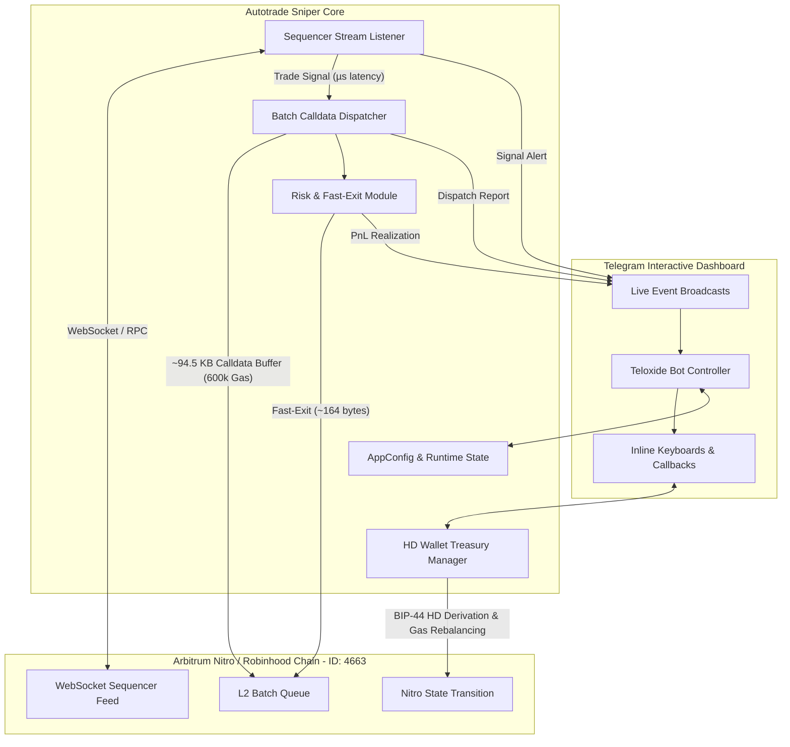

# HIGH-FREQUENCY ON-CHAIN SIGNAL REPLICATOR & BATCH-SEQUENCING ENGINE (RUST + TELEGRAM UI)

Sistem perdagangan otomatis berkinerja tinggi (**Automated Quantitative Execution Engine**) yang dibangun menggunakan bahasa pemrograman **Rust** khusus untuk jaringan EVM Layer-2 **Arbitrum Nitro / Robinhood Chain (Chain ID: 4663, Native Asset: ETH)**.

Dilengkapi dengan antarmuka kendali penuh berbasis **Telegram Bot (Teloxide Interactive UI & Inline Keyboards)** untuk pemantauan, konfigurasi parameter, dan eksekusi langsung secara real-time dari perangkat seluler.

---

## 🏛️ ARSITEKTUR SISTEM



---

## 🚀 FITUR UTAMA

### 1. Arsitektur Dompet Berjenjang (HD Master & Deterministic Satellite Treasury)
- **Master Account (Akun Induk):**
  - Inisialisasi otomatis via 12-word BIP-39 Mnemonic Phrase atau impor frasa pemulihan yang sudah ada.
  - Bertindak sebagai akun perbendaharaan utama dan eksekutor posisi inti.
- **Deterministic Sub-Accounts (Akun Satelit):**
  - Diturunkan secara deterministik menggunakan standar BIP-44:
    $$\text{Derivation Path} = m/44'/60'/0'/0/\{\text{index}\} \quad (\text{Index } 1, 2, 3, \dots)$$
  - Seluruh sub-akun dapat dipulihkan hanya dengan satu frasa pemulihan Akun Induk.
- **Automated Gas Rebalancing:**
  - Alokasi gas internal otomatis: jika saldo ETH sub-akun berada di bawah ambang batas minimum (`MIN_SUB_ACCOUNT_ETH`), Akun Induk otomatis mendistribusikan saldo operasional hingga mencapai `REBALANCE_TARGET_ETH`.

### 2. Stream Listener & On-Chain Signal Replication
- **Koneksi Sequencer Real-Time:**
  - Terhubung langsung ke aliran data WebSocket Sequencer Feed (`RPC_WS_URL`) dan failover HTTP RPC node Robinhood Chain (Chain ID: 4663).
- **Filter Akun Pantauan (`WATCHLIST_ACCOUNTS`):**
  - Memindai transaksi feed asinkron dengan lookup instan $O(1)$ pada memori.
  - Begitu terdeteksi transaksi pertukaran aset (Swap/Buy) pada kurva likuiditas dari akun pantauan (fungsi selector: Uniswap V2/V3, Camelot, Multicall, Universal Router), sistem mengekstrak parameter target (**Token Contract, Pool Address, Entry Amount**) dalam latensi mikrodetik.

### 3. Batch Calldata Buffer Formatting (L2 Payload Calibration)
- **Konstruksi Calldata Buffer:**
  - Menyusun instruksi swap aset standar pada kontrak router/pool.
  - Menyematkan buffer data statis (Null Byte Array) di bagian akhir payload transaksi hingga mencapai ukuran target ~94.500 byte:
    ```rust
    let buffer_payload = [swap_calldata, vec![0u8; 94500]].concat();
    ```
  - Mengkalibrasi pemanfaatan kuota calldata per batch L2 sequencer Robinhood Chain.
- **Parameter Jaringan:**
  - Alokasi Gas Limit statis: `600.000` gas.
  - Optimasi EIP-1559 Priority Fee & Max Fee per Gas agar transaksi diproses secara deterministik di urutan teratas antrean batch.

### 4. Concurrent Multi-Account Dispatcher
- **Mode Eksekusi Tunggal (Single Execution):**
  - Akun Induk menyiarkan satu transaksi ber-buffer calldata segera setelah sinyal terkonfirmasi.
- **Mode Eksekusi Bertingkat (Multi-Account Sequence):**
  - Memanfaatkan `tokio::spawn` untuk menyiarkan transaksi berurutan secara paralel dari Akun Induk (alokasi utama) dan Sub-Akun Satelit (alokasi mikro pendukung) untuk memastikan kontinuitas eksekusi pada beberapa blok sequencer berikutnya.

### 5. Risk Management & Position Lifecycle (Fast-Exit Module)
- **Target Profit Realization:** Menutup posisi secara otomatis jika margin keuntungan mencapai target persentase (misal: `+25%`, `+35%`, `+50%`).
- **Time-Decay Exit (Stop-Loss Waktu):** Jika dalam batas durasi tahan (default: `45 detik`) volume perdagangan tidak meningkat, sistem mengeksekusi likuidasi instan di pasar untuk membatasi risiko.
- **Format Transaksi Keluar:** Transaksi penutupan posisi menggunakan calldata swap standar tanpa buffer data tambahan (**~164 byte**) untuk menjamin eksekusi berlatensi sub-milidetik.

### 6. Interactive Telegram Dashboard (Teloxide UI)
- **Menu Utama (`/start` atau `/menu`):**
  - `🎯 Signal Accounts` $\rightarrow$ Tambah, Hapus, dan Lihat daftar pantauan akun.
  - `💼 Treasury & Wallets` $\rightarrow$ Status Akun Induk, Sub-Akun Satelit, Buat Akun Baru, Impor Mnemonic, dan Rebalance Gas.
  - `⚙️ Execution Settings` $\rightarrow$ Toggle Mode (Single / Multi-Account), Atur Target Profit, Atur Time-Decay Exit, Kalibrasi Buffer (94.5 KB).
  - `⚡ Bot Engine [ON / OFF]` $\rightarrow$ Toggle scanner feed aktif / jeda secara instan.
  - `📈 Portfolio & Status` $\rightarrow$ Saldo ETH real-time, jumlah posisi aktif, dan riwayat PnL.
- **Live Event Broadcast ke Telegram:**
  - 🔔 *Sinyal Terdeteksi:* Akun pantauan melakukan entri pada token target.
  - 🚀 *Dispatch Berhasil:* Ringkasan blok sequencer, mode eksekusi, ukuran buffer, dan daftar hash transaksi.
  - 📊 *Realisasi Posisi:* Notifikasi penutupan posisi (Target Profit / Time-Decay Liquidation) dengan hasil % PnL dan TX hash keluaran ~164 byte.

---

## 📂 STRUKTUR DIREKTORI PROYEK

```
autotradesniper/
├── Cargo.toml            # Definisi dependencies (Alloy 2.5, Tokio, Teloxide, BIP-39/BIP-32)
├── .env.example          # Template konfigurasi environment
├── .env                  # Konfigurasi aktif lokal
├── runtime_config.json   # State konfigurasi dinamis yang dipersistensikan dari Telegram UI
├── README.md             # Dokumentasi sistem lengkap
└── src/
    ├── main.rs           # Entry point, orkestrasi task Tokio asinkron & Telegram dispatcher
    ├── config.rs         # Manajer konfigurasi dinamis, thread-safe RwLock, dan persistensi JSON
    ├── types.rs          # Tipe data sinyal on-chain, mode eksekusi, laporan dispatch, & posisi PnL
    ├── wallet.rs         # BIP-39 HD Master treasury, BIP-44 sub-akun derivatif & auto gas rebalance
    ├── stream.rs         # WebSocket feed listener & ekstraksi sinyal kurva likuiditas latensi mikrodetik
    ├── dispatcher.rs     # Calldata buffer formatting (94.5 KB) & concurrent multi-account dispatch
    ├── risk.rs           # Siklus hidup posisi, target profit realization, time-decay & fast-exit (164 B)
    └── telegram.rs       # Teloxide Inline Keyboard dashboard, callback handlers & live event alerts
```

---

## ⚙️ SETUP ENVIRONMENT (`.env`)

Salin file `.env.example` ke `.env` dan sesuaikan parameter operasional:

```bash
cp .env.example .env
```

Isi file `.env`:

```env
# RPC & Sequencer Endpoints
RPC_HTTP_URL=https://rpc.robinhood.com
RPC_WS_URL=wss://rpc.robinhood.com/ws
CHAIN_ID=4663

# Telegram Interactive Bot Configuration
TELEGRAM_BOT_TOKEN=7891234567:AAExampleTelegramBotTokenHere
TELEGRAM_AUTHORIZED_CHAT_ID=123456789

# Master HD Wallet BIP-39 Mnemonic Phrase (12 Words)
# Jika kosong, sistem otomatis men-generate frasa baru saat start
MNEMONIC_PHRASE=""

# Watchlist Addresses to Monitor (Pisahkan koma)
WATCHLIST_ACCOUNTS=0x742d35cc6634c0532925a3b844bc454e4438f44e,0x53844f9577c2334e541aec7df7174ece5df1fcf0

# Batch Sequencer Calldata Buffer Configuration (L2 Payload Calibration)
BUFFER_SIZE=94500
GAS_LIMIT=600000
MAX_PRIORITY_FEE_GWEI=2.5
MAX_FEE_GWEI=15.0

# Trading & Risk Parameters
DEFAULT_TRADE_ETH=0.05
SLIPPAGE_PERCENT=1.0
TARGET_PROFIT_PERCENT=35.0
TIME_DECAY_EXIT_SECONDS=45

# Multi-Account Sequencing (Single atau MultiAccount)
EXECUTION_MODE=MultiAccount
SUB_ACCOUNT_COUNT=2
MIN_SUB_ACCOUNT_ETH=0.005
REBALANCE_TARGET_ETH=0.015
```

---

## 🔨 PANDUAN KOMPILASI & MENJALANKAN

### 1. Kompilasi Mode Release
Gunakan flag `--release` untuk optimasi biner performa tinggi:
```powershell
cargo build --release
```

Hasil biner executable akan tersedia di `target/release/autotradesniper.exe`.

### 2. Menjalankan Engine
```powershell
cargo run --release
```

Atau jalankan biner secara langsung:
```powershell
.\target\release\autotradesniper.exe
```

---

## 📱 PANDUAN PENGGUNAAN TELEGRAM BOT

1. Dapatkan Bot Token dari [@BotFather](https://t.me/botfather) di Telegram.
2. Dapatkan Chat ID Anda (menggunakan bot seperti [@userinfobot](https://t.me/userinfobot)).
3. Masukkan token dan chat ID pada file `.env`.
4. Buka bot di aplikasi Telegram seluler atau desktop dan kirim perintah `/start` atau `/menu`.
5. Gunakan tombol interaktif:
   - **`🎯 Signal Accounts`**: Klik `➕ Tambah Alamat` lalu ketik alamat target `0x...` untuk mulai memantau.
   - **`💼 Treasury & Wallets`**: Klik `🔑 Buat Akun Induk Baru` untuk menghasilkan wallet baru, atau `⛽ Rebalance Saldo Operasional` untuk mendistribusikan gas ke satelit.
   - **`⚙️ Execution Settings`**: Beralih antara mode *Single* dan *Multi-Account Sequence*, serta sesuaikan target take-profit (+25% s.d. +50%).
   - **`⚡ Bot Engine [ON / OFF]`**: Mengaktifkan atau menjeda deteksi secara instan tanpa perlu mematikan aplikasi.
