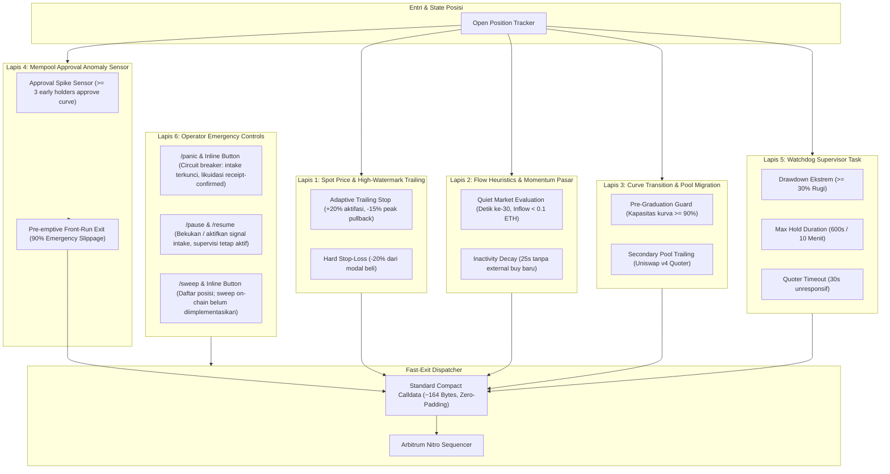
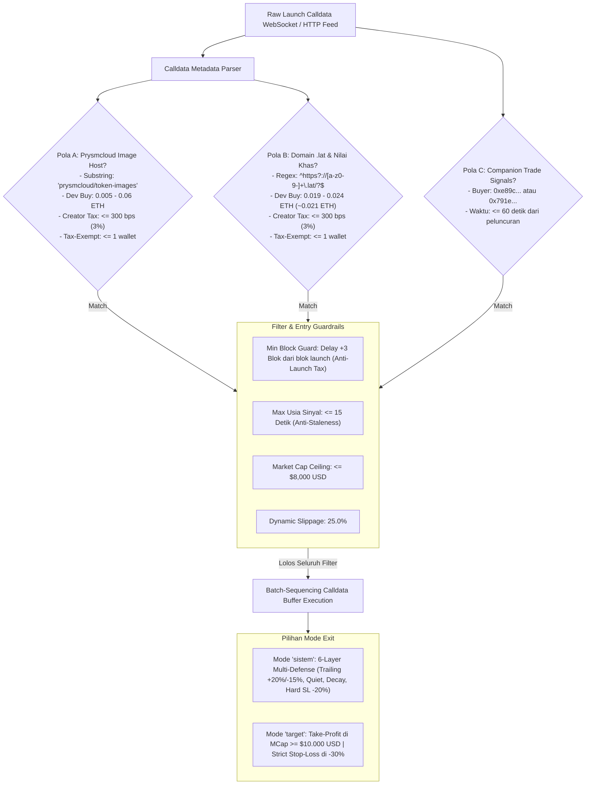
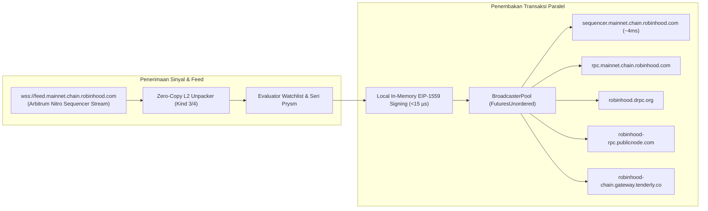

# HIGH-FREQUENCY ON-CHAIN SIGNAL REPLICATOR & BATCH-SEQUENCING ENGINE (RUST + TELEGRAM UI)

Sistem perdagangan otomatis berkinerja tinggi (**Automated Quantitative Execution Engine**) yang dibangun menggunakan bahasa pemrograman **Rust** khusus untuk jaringan EVM Layer-2 **Arbitrum Nitro / Robinhood Chain (Chain ID: 4663, Native Asset: ETH)**.

Dilengkapi dengan antarmuka kendali penuh berbasis **Telegram Bot (Teloxide Interactive UI & Inline Keyboards)** untuk pemantauan, konfigurasi parameter, eksekusi darurat satu-klik, dan kontrol posisi real-time dari perangkat seluler.

---

## 🛡️ ARSITEKTUR RISK MANAGEMENT BERLAPIS (6-LAYER DEFENSIVE EXECUTION PIPELINE)

Sistem mengimplementasikan sistem mitigasi risiko dan siklus penutupan posisi (*Position Exit & Risk Mitigation Architecture*) berlapis 6 tingkat (**6-Layer Defense**) yang dievaluasi secara non-blocking dalam hitungan **nanodetik (< 100 ns)**:



### Rincian 6 Lapis Pertahanan:

1. **Lapis 1: Aturan Harga Spot & High-Watermark Trailing (`src/risk/price_rules.rs`)**
   - **Adaptive High-Watermark Trailing:** Terpicu otomatis saat harga spot posisi mencapai laba $\ge +20\%$ (`TRAIL_ACTIVATE = 20.0%`). Setelah aktif, sistem mencatat titik puncak tertinggi (*High-Water Mark*). Jika harga terkoreksi sebesar **$15\%$ dari titik puncak** (`TRAIL_DIST = 15.0%`), posisi seketika dilikuidasi untuk mengunci margin laba.
   - **Hard Stop-Loss Otomatis:** Jika harga spot kurva menyentuh **$-20\%$** (`STOP_LOSS = 20.0%`) dari harga beli awal, posisi dilikuidasi seketika.

2. **Lapis 2: Heuristik Aliran Dana & Momentum Pasar (`src/risk/flow_rules.rs`)**
   - **Quiet Market Evaluation (`sepi`):** Dievaluasi tepat pada detik ke-**30** setelah transaksi entri terkonfirmasi (`QUIET_EXIT_SECONDS = 30`). Jika total dana masuk dari pihak ketiga **$< 0.1 \text{ ETH}$**, sistem melikuidasi posisi (`ExitReason::QuietMarket`).
   - **Inactivity Decay (`idle`):** Jika tidak ada aktivitas beli eksternal baru selama **25 detik berturut-turut** (`IDLE_TIMEOUT_SECONDS = 25`), posisi segera ditutup (`ExitReason::InactivityDecay`) sebelum likuiditas kurva menyusut.

3. **Lapis 3: Transisi Kelulusan Kurva & Pool Migration (`src/risk/migration_rules.rs`)**
   - **Pre-Graduation Guard (`pre_grad`):** Jika kapasitas kurva bonding mencapai **$\ge 90\%$** (`GRAD_GUARD = 90.0%`), sistem melikuidasi posisi lebih awal sebelum transisi cliff likuiditas ke Uniswap pool sekunder.
   - **Secondary Pool Trailing (`pool_exit`):** Posisi yang bertransisi ke pool Uniswap v4 dikawal oleh kuotasi quoter sekunder dengan trailing stop dan stop-loss adaptif.

4. **Lapis 4: Mempool Approval Anomaly Sensor (`src/risk/anomaly_sensor.rs`)**
   - **Sensor Anomali Persetujuan:** Memindai mempool feed secara real-time. Jika terdeteksi **$\ge 3$ holder awal** menyetujui transaksi *Approve* token sasaran ke router kurva dalam jendela waktu singkat (indikasi *pre-dump*), sistem memicu likuidasi darurat mendahului pasar (*pre-emptive front-run exit*) dengan toleransi *slippage* **$90\%$** dan gas priority fee agresif.

5. **Lapis 5: Watchdog Supervisor Task (`src/risk/watchdog.rs`)**
   - Berjalan pada background task terisolasi dengan siklus presisi 5 detik (`tokio::time::interval(5s)`):
     - **Watchdog Drawdown:** Likuidasi seketika tanpa syarat jika posisi mengalami kerugian $\ge 30\%$ (`ExitReason::WatchdogDrawdown`).
     - **Watchdog Max Hold:** Likuidasi otomatis jika posisi tertahan lebih dari **600 detik (10 menit)** (`ExitReason::WatchdogTimeout`).
     - **Pool Quote Timeout:** Likuidasi jika quoter harga pool sekunder gagal merespons selama **30 detik berturut-turut** (`ExitReason::PoolQuoteTimeout`).

6. **Lapis 6: Kontrol Operator & Penutupan Darurat Manual (`src/telegram/control.rs` & `src/telegram.rs`)**
   - **Command `/panic` & Tombol Inline `🚨 PANIC SELL ALL` (circuit breaker):** intake berhenti dan terkunci saat itu juga (dua store atomik,
     tanpa lock/await), antrean order Prysm dan batch pre-sign dipotong, lalu setiap posisi dijual lewat exit receipt-confirmed di runtime
     engine. Operator langsung mendapat layar "breaker aktif"; laporan per posisi menyusul sebagai notifikasi kritis. Entri yang sedang
     terkirim saat breaker dipicu otomatis dijual begitu terdaftar. Intake hanya bisa aktif lagi lewat tombol `🔓` setelah likuidasi selesai.
   - **Command `/pause` / `/resume` & tombol Intake:** membekukan / mengaktifkan intake (tombol membawa status tujuan, jadi tombol lama tidak
     pernah membalik engine). Pause juga membatalkan order Prysm yang antre dan melepas batch pre-sign; posisi terbuka tetap diawasi.
   - **Command `/sweep` & Tombol `🧹 Sweep Assets`:** menampilkan posisi yang tercatat. Sweep token residual on-chain **belum**
     diimplementasikan; untuk menjual semua posisi gunakan Panic Sell.

---

---

## 🔬 STRATEGI MANDIRI: "SERI PRYSM" (FAST-PATH PATTERN EVALUATOR)

Sistem mengintegrasikan modul strategi perdagangan otonom bernama **"Seri Prysm" (`src/models/prysm.rs`)**. Modul ini beroperasi secara independen tanpa bergantung pada daftar akun pantauan (*watchlist*), memindai metadata calldata peluncuran token secara paralel, dan mengeksekusi posisi seketika ketika sidik jari metadata cocok dengan pola operator Seri Prysm:



### 🔹 3 Pola Sidik Jari Metadata:
1. **Pola A (Prysmcloud Image Storage):**
   - Substring URL Gambar: `"prysmcloud/token-images"` (hosting vercel-storage / IPFS).
   - Alokasi Developer Buy: Rentang `0.005 ETH` hingga `0.06 ETH`.
   - Creator Tax: $\le 300\text{ bps}$ ($3\%$).
   - Tax-Exempt Wallets: $\le 1$ alamat selain developer (proteksi *anti-bundle*).
2. **Pola B (Domain `.lat` & Karakteristik Dev Buy ~0.021 ETH):**
   - Pola Regex Domain Website: `^https?://[a-z0-9-]+\.lat/?$`
   - Dev Buy Spesifik: Rentang ketat `0.019 ETH` hingga `0.024 ETH` (karakteristik khas operator $\approx 0.021\text{ ETH}$).
   - Creator Tax: $\le 300\text{ bps}$ ($3\%$), Tax-Exempt Wallets $\le 1$.
3. **Pola C (Companion Trade Signals):**
   - Sinyal beli dari dompet rekanan teridentifikasi:
     - `0xe89c3d903e84aab1c6327c794ea8e749b60a347c`
     - `0x791ef6e64a3fb267502ceb950b57a81671974065`
   - Terjadi dalam jendela waktu $\le 60\text{ detik}$ sejak blok peluncuran token.

### 🛡️ Guardrails & Mode Keluar (Exit Modes):
- **Min Block Guard (`PRYSM_MIN_BLOCK_DELAY`):** nilai ini adalah blok tempat entry *mendarat* relatif terhadap blok launch L. Order ditembakkan begitu blok `L + delay - 1` teramati di feed **dan** alamat token/kurva sudah terselesaikan dari receipt launch (resolver latar belakang), sehingga `1` = mendarat di Blok +1. Revert Guard tetap melindungi bila tx jatuh di jendela pajak 99%.
- **Max Usia Sinyal:** $\le 15\text{ detik}$ (menolak sinyal usang/stale).
- **Market Cap Ceiling:** $\le \$8.000\text{ USD}$ saat pemicuan order.
- **Dua Pilihan Mode Exit:**
  - `sistem`: Memakai siklus proteksi 6 lapis standar (Trailing profit +20% act, -15% peak, Quiet market 30s <0.1 ETH, Inactivity decay 25s, Hard SL -20%).
  - `target`: Take-profit otomatis saat kapitalisasi pasar menyentuh **$\ge \$10.000\text{ USD}$** atau proteksi *strict stop-loss* pada **$-30\%$**.

---

## 🪞 IN-MEMORY CURVE REPLICA (ZERO-RPC RISK LOOP)

Loop risiko 100 ms dulu memanggil `eth_call getReserves()` per posisi per tick (**600/menit/posisi**, 50-200 ms, rawan 429).
Kini posisi Pons dinilai dari replika reserve kurva di memori (`src/risk/curve_mirror.rs`).

**Sumber data.** Feed sequencer Nitro hanya membawa transaksi, bukan event log. Setiap `buy`/`sell` ke kurva yang dipegang
disimulasikan dari calldata-nya dengan matematika integer yang sama dengan jalur RPC (fee + creator tax keluar dari reserve,
`eth * tok` konstan), termasuk prediksi revert pada `minOut`. State = **anchor** (`getReserves()` yang di-pin ke nomor blok
eksplisit, bukan `latest`) + **jurnal** trade sesudah blok itu, diurutkan `(blok, indeks)`, sehingga urutan kedatangan dari
feed yang berlomba tidak mengubah hasil.

**Kapan RPC tetap dipakai (fallback transparan).** Baca mirror hanya `Fresh` bila kurva terjangkar, tidak dicurigai, feed hidup
(ada blok dalam `MIRROR_STALE_AFTER_MS`; setiap blok yang tidak menyentuh kurva = bukti "tidak berubah"), dan tidak ada blok
hilang di atas anchor yang melewati `MIRROR_GAP_GRACE_MS`. Selain itu loop membaca RPC seperti sebelumnya.

| Kondisi | Penanganan |
|---|---|
| Blok hilang (gap) | ditunggu selama grace (feed lain bisa mengisi), lalu dibaca ulang tepat di blok sesudah gap |
| Blok tak terbaca (backlog basi, payload rusak, pesan L1/delayed-inbox tanpa tx bertanda tangan) | dianggap gap seketika |
| Blok datang tidak berurutan | jurnal diputar ulang dari anchor |
| Reorg (feed mengirim blok yang sama dengan isi berbeda) | jurnal dari blok itu dibuang, baca ulang di head |
| Panggilan yang tidak bisa didekode (router/aggregator yang menyebut alamat kurva, selector lain) | kurva dicurigai sampai dibaca ulang |
| Prediksi revert terlalu tipis (< 10 bps), angka calldata yang overflow | kurva dicurigai; sell > total supply = revert pasti |
| Penomoran blok feed vs RPC (`FEED_GENESIS_BLOCK`) | dicek dengan selisih head dan, persis, dengan hash tx sampel di blok yang sama; salah = mirror mati, semua ke RPC |
| Verifikasi berkala | baca ulang tiap `MIRROR_VERIFY_SECS`; selisih prediksi dicatat (ppb), fee + creator tax dikalibrasi dari dua anchor |

**Exit.** Loop dibangunkan setiap kali kurva yang dipegang berubah (bukan hanya tiap 100 ms). Exit berbasis harga yang dihitung
dari trade prediksi dikonfirmasi dulu dengan satu baca terjangkar di blok pemicu (`MIRROR_CONFIRM_EXITS`), karena `sell` di feed
masih bisa revert (sell tanpa saldo, buy kehabisan gas): dump/pump palsu tidak memicu jual, dan peak trailing yang dibangun dari
trade palsu dikoreksi. Floor `minOut` dihitung dari state terkonfirmasi dengan slippage adaptif (volatilitas terbaru), balance &
approval master tidak dibaca ulang sebelum jual pertama, dan posisi **hanya ditutup setelah receipt status 1** (tanpa receipt:
saldo harus turun dari bacaan segar, atau nol bila jumlahnya dari bacaan lama). Sell yang revert membuat mirror dibaca ulang.

**Angka** (`cargo test --test curve_mirror`, `cargo bench --bench mirror_latency`, container 2 core):
- `getReserves`: **600/menit/posisi → 0** di antara verifikasi; dengan default (verifikasi 30 dtk) ≈ 2/menit per kurva
  + 1 `eth_blockNumber`/menit + 1 baca per exit yang dikonfirmasi (**-99,7%**).
- Baca mirror + valuasi posisi: **≈ 153 ns** median (p99 < 0,6 µs). Biaya feed per tx: 3 ns tanpa kurva dilacak, ≈ 110-250 ns
  dengan kurva dilacak, ≈ 0,35 µs untuk trade yang diterapkan.

**Asumsi yang perlu Anda verifikasi terhadap kontrak Pons V2:** fee + creator tax keluar dari reserve (invarian `eth*tok`
diuji di setiap anchor; bila patah, log memperingatkan dan kurva diverifikasi tiap 2 dtk), jadwal snipe tax 9900/618/19 bps per
detik sejak launch, dan rumus kapasitas graduation `(E - 1,68)/4,2 ETH` (V2 lulus saat kurva habis terjual).

---

## 🧊 AOT PRE-SIGNING PIPELINE (ZERO-CRYPTO HOT PATH)

Tanda tangan ECDSA + keccak atas tx berkalldata 94,5 KB (≈ **0,70 ms per tx** di rilis: 0,29 ms signature hash + 0,09 ms
`sign_hash` + 0,28 ms hash envelope + 0,01 ms body hex/JSON) tidak lagi dibayar saat blok target tiba.

**Dua fase staging** (`Dispatcher::arm_presign` / `stage_primary`):
1. **Saat pola A/B cocok** - batch dibuat per launch; tiap akun satelit (carrier, `value = 0`, tidak butuh data launch) diberi
   *NonceLease* dan ditandatangani di satu thread blocking. Bytes mentah EIP-2718 + body JSON-RPC (hex sekali) disimpan di memori.
2. **Saat T_LAUNCH ter-resolve** dan order masih menunggu blok target - alamat kurva diketahui, jadi *primary* (master, beli kurva
   Pons dengan Revert Guard `minTokensOut`) ikut ditandatangani dengan nonce master yang di-lease.

**Dispatch** (`dispatch_signal`) meng-*claim* batch lewat compare-exchange (`Staged -> Claimed -> Dispatched`; hanya satu dari
dispatch / cancel / expiry yang menang), memvalidasi tiap paket terhadap fee dan quote live, lalu `broadcast_body` menulis
bytes tersimpan ke socket - tanpa signing. Paket yang basi ditandatangani ulang **dengan nonce yang sama** (tidak ada lubang nonce).

| Invalidasi | Kondisi (default) | Tindakan |
|---|---|---|
| FeeDrift | fee cap staged < fee live x (1 - 10%) | re-sign proaktif tiap blok baru / saat claim |
| GasDrift | gas limit < intrinsik + cadangan + komponen L1 saat ini | re-sign |
| QuoteDrift | `minTokensOut` beda > 2% dari quote baru (hanya kata itu yang boleh beda) | re-stage primary, nonce sama |
| TargetMismatch / ParamsChanged | token/kurva, ukuran buffer atau gas limit berubah | re-sign inline |
| Expired | batch lebih tua dari `PRESIGN_MAX_HOLD_MS` (8 s) | janitor melepas lease |
| NonceOvertaken | node melaporkan pending nonce > nonce lease | paket dibuang, nonce baru |
| Cancel | order ditolak / launch gagal / mcap / stale / Prysm dimatikan / `cancel_launch` | semua lease dikembalikan |

**Keamanan nonce:** nonce yang di-lease kebal terhadap `return_nonce`/`reconcile_nonce` (healing celah), sehingga tx yang sudah
ditandatangani tidak pernah kehilangan nonce-nya; lease yang dilepas/di-drop mengembalikan nonce hanya bila belum terpakai di chain.

**Penjadwalan deterministik** (`models/prysm.rs`): resolver receipt memakai `tokio::time::interval` laju-tetap
(`MissedTickBehavior::Delay`) digabung `watch::changed()` yang berbunyi sekali per blok tertinggi baru, jadi tidak ada drift
`sleep(60 ms) + RTT` dan resolver bangun seketika saat blok L+1 terbit. Transisi `Pending -> Dispatched` terjadi di bawah satu
lock `pending_orders` (tepat sekali, thread-safe); jalur feed tanpa antrean hanya satu load atomik.

**Batasan yang perlu diketahui:** (a) *primary* baru bisa di-pre-sign setelah T_LAUNCH ter-resolve; pada profil default
`PRYSM_MIN_BLOCK_DELAY=1` order langsung jatuh tempo saat resolve, jadi yang terbantu hanya carrier (primary ditandatangani inline);
(b) nonce yang ditahan menunda tx lain dari akun yang sama sampai batch dikirim/dibatalkan/kedaluwarsa (dibatasi `PRESIGN_MAX_HOLD_MS`);
(c) polling receipt (rata-rata ~30 ms deteksi) tetap latensi dominan - langkah lanjut: `eth_subscribe logs` (push) menggantikan polling.

**Hasil `cargo bench --bench presign_latency`** (container 2 core, loopback; angka absolut adalah batas bawah, selisih antar-mode
adalah penghematan - jalankan ulang di mesin Anda):

| Mode (4 tx, 2 worker) | Tx pertama tiba (median) | Tx terakhir tiba (median) |
|---|---|---|
| on-the-fly | 2,07 ms | 3,09 ms |
| carrier staged (default Block +1) | 0,81 ms | 1,22 ms |
| fully staged (order menunggu blok) | 0,49 ms | 0,67 ms |

Dengan 8 tx pada 2 worker: 6,92 ms -> 1,34 ms (fully staged). Menandatangani N tx paralel di sedikit core menyerialisasi; staging
menghilangkan kontensi itu.

---

## 📡 ANTARMUKA TELEGRAM (CONTROL PLANE TERISOLASI)

**Isolasi:** polling, handler, render layar, pembacaan saldo, dan outbox notifikasi berjalan di thread OS `telegram-io` dengan
runtime tokio single-thread sendiri (`telegram::start_control_plane`). Sisi Telegram **tidak pernah memegang lock engine**: setiap
pembacaan/perubahan state dijalankan sebagai task di runtime engine (`ControlPlane`, `src/telegram/control.rs`) dan hanya ditunggu,
dengan batas waktu. Engine mengirim alert lewat `Notifier::notify` (satu `try_send`, tanpa await).

| Tombol | Efek ke engine (tanpa restart) |
|---|---|
| `👥 1/2/3/5 Anak` | layout akun baru diturunkan + nonce carrier yang bergabung dibaca dari chain **sebelum** commit (gagal baca = dibatalkan); batch pre-sign yang siap di-resize (slot dilepas / ditambah dan ditandatangani) |
| `⚡ 1.0G / 🚀 2.5G / 🔥 5.0G` | pasangan (tip, max fee) ditukar atomik (seqlock), floor fee adjuster ikut; paket staged di luar toleransi ditandatangani ulang dengan nonce yang sama (naik maupun turun) |
| `📦 95 KB / 0 KB` | saklar padding: 0 KB = satu tx master tanpa padding, tanpa carrier (lease carrier dikembalikan); 95 KB = carrier + padding ~94,5 KB kembali |
| `Intake` / `Mode` | status tujuan ada di tombol (`intake:on/off`, `cfg_mode:single/multi`): tombol lama atau tekanan ganda tidak pernah membalik engine; pause melepas antrean & batch |
| `🚨 PANIC SELL ALL` | circuit breaker (lihat Lapis 6); `/panic` dan tombol ini melewati antrean per-chat. Latch ber-epoch: tombol `🔓` hanya melepas breaker yang ia tampilkan, dan ditolak selama likuidasi / exit / entri masih berjalan |

**Telemetri** (`/start`, `📡 Telemetri`): saldo ETH Ayah + semua Anak (dibaca paralel, batas 3 dtk, "?" bila tidak terbaca),
feed racing (feed live, % menang `ClaimRing`, RTT, lag), status curve mirror (ZERO-RPC / campuran / fallback RPC per kurva),
pre-sign AOT, posisi terbuka dengan PnL real-time dan sumber valuasinya, statistik outbox.

**Keamanan output:** semua nilai dinamis di-escape (`html::escape`), setiap layar divalidasi parser HTML Telegram yang ketat
(`html::validate`), dipotong di batas 4096 unit UTF-16 (`html::fit`), dan bila Telegram tetap menolak, dikirim ulang sebagai teks
polos. **Outbox berbatas:** 64 notifikasi menunggu (lebih = dibuang & dihitung), notifikasi yang menumpuk digabung jadi satu pesan,
TTL 90 dtk untuk notifikasi rutin (notifikasi kritis tidak kedaluwarsa dan didahulukan), retry dibatasi (`RetryAfter` ≤ 30 dtk,
3 percobaan), jumlah notifikasi yang hilang diumumkan di pesan berikutnya.

**Dompet:** ganti / impor mnemonic hanya bila intake di-pause dan tidak ada entri dalam pengiriman, posisi terbuka, exit berjalan,
batch staged, atau order antre; frasa seed yang ditempel di chat dihapus otomatis.

---

## ⚡ RINGKASAN OPTIMASI PERFORMA & LATENSI (< 100 µs TARGET)

Pengujian micro-benchmark nyata dilakukan menggunakan harness **Criterion**:

| Komponen Pipeline | Modul Rust | Metode Optimasi | Latensi Eksekusi (Criterion) |
| :--- | :--- | :--- | :--- |
| **Pola A Evaluation** | `src/models/prysm.rs` | Zero-Allocation Substring Match | **10.08 ns** (0.010 µs) |
| **Pola B Evaluation** | `src/models/prysm.rs` | Pre-compiled Static Regex Matching | **39.27 ns** (0.039 µs) |
| **Pola C Evaluation** | `src/models/prysm.rs` | Fast Address Lookups & Temporal Delta | **8.05 ns** (0.008 µs) |
| **Prefilter Tx Feed** | `src/stream/raw_tx.rs` | RLP dibaca di tempat, `to`/`value`/calldata dipinjam (`RawTxView`), 0 alokasi | **36.7 ns** (vs 232.6 ns decode penuh) |
| **Pencocokan Alamat** | `src/addr_set.rs` | Probe `[u8; 20]` bitwise, tanpa hash/lock (`AddressSet`) | **5.2 ns** miss / **2.6 ns** hit (vs 21.7 ns `HashSet`) |
| **Lookup Watchlist** | `src/config.rs` | Snapshot `AddressSet` tanpa `await` (`Watchlist::contains`) | **24 ns** (vs 60 ns `tokio::RwLock` + `HashSet`) |
| **Klaim "first-packet wins"** | `src/stream/feed.rs` | Cincin atomik lock-free (`ClaimRing`) | **23 ns** (menang + duplikat) |
| **Signature Matching** | `src/stream.rs` | 1-Cycle Integer Bitwise Match (`fast_selectors`) | **832.22 ps** (0.0008 µs) |
| **Nonce Allocation** | `src/wallet.rs` | Lock-Free In-Memory Atomic Nonce (`AtomicU64`) | **1.52 ns** (0.0015 µs) |
| **Calldata Buffer Assembly** | `src/payload.rs` | Vectorized `std::ptr::write_bytes` Zero-Fill (94.5 KB) | **1.27 µs** (1.270 µs) |
| **Gas Fee Calculation** | `src/payload.rs` | Lock-Free Exponential Moving Average (EMA) | **6.84 ns** (0.0068 µs) |
| **Fast-Exit Payload Generation** | `src/payload.rs` | Packed Compact Array (~164 Bytes) | **28.73 ns** (0.0287 µs) |
| **6-Layer Risk Evaluator** | `src/risk/evaluator.rs` | Zero-Allocation Multi-Rule Block Decision | **85.96 ns** (0.0859 µs) |
| **Total Internal Compute Latency** | **Pipeline Lengkap** | **Zero-Copy & Pre-computed End-to-End** | **~1.7 mikrodetik (µs)** |

> Seluruh evaluator pola Seri Prysm dieksekusi dalam **8 hingga 39 nanodetik**, jauh melampaui standar latensi tinggi.

> **Catatan jujur tentang "total compute".** Angka ~1,7 µs di atas **tidak** menyertakan pemulihan alamat pengirim. `from` tidak ada di payload feed (hanya tanda tangan), sehingga setiap tx kandidat (swap yang bisa di-copy / panggilan ke launchpad) masih membayar `ecrecover`: **~229 µs** dengan backend `k256` bawaan, **~47 µs** dengan libsecp256k1 (ukur dengan benchmark `tx_ecrecover_sender`; aktifkan dengan menambah feature `"secp256k1"` pada dependensi `alloy` di `Cargo.toml`, butuh toolchain C). Prefilter `RawTxView` memastikan hanya tx kandidat yang membayarnya.

---

## 📂 STRUKTUR DIREKTORI PROYEK

```
autotradesniper/
├── Cargo.toml                  # Definisi dependency (Alloy, Tokio, Teloxide, Regex, Criterion)
├── .env.example                # Template konfigurasi environment
├── .env                        # Konfigurasi aktif lokal
├── runtime_config.json         # State konfigurasi dinamis yang dipersistensikan
├── README.md                   # Dokumentasi sistem & laporan audit performa
├── benches/
│   ├── latency_benchmark.rs    # Criterion microsecond latency benchmark suite
│   ├── presign_latency.rs      # Pre-signed vs on-the-fly: biaya per tx & latensi dispatch end-to-end
│   └── mirror_latency.rs       # Biaya baca mirror kurva & biaya per tx di jalur feed
├── tests/
│   ├── risk_tests.rs           # Test suite komprehensif 6 lapis pertahanan risk engine
│   ├── prysm_tests.rs          # Test suite komprehensif Pola A/B/C, Guardrails & Exit Mode Seri Prysm
│   ├── presign_pipeline.rs     # Regresi AOT pre-signing: keabsahan paket, pembatalan aman, nonce lease, eksekusi instan
│   └── curve_mirror.rs         # Regresi mirror kurva: sinkronisasi, celah/reorg, loop risiko tanpa RPC, exit berbasis receipt
└── src/
    ├── lib.rs                  # Root library & MinGW compatibility symbols
    ├── main.rs                 # Entry point & Tokio concurrent task supervisor
    ├── payload.rs              # Zero-Fill Calldata Builder (94.5 KB) & EMA Fee Adjuster
    ├── config.rs               # Runtime configuration, thread-safe RwLock, JSON persistence
    ├── types.rs                # Data structures: TradeSignal, DispatchReport, Position, PrysmExitMode
    ├── wallet.rs               # BIP-39 HD Master, BIP-44 Sub-Accounts & Atomic Nonces
    ├── stream.rs               # Real-Time Arbitrum Nitro Sequencer Feed Streamer & L2 Unpacker
    ├── dispatcher.rs           # Direct Sequencer BroadcasterPool & Pipelined Parallel Signing
    ├── dispatcher/
    │   └── presign.rs          # AOT pre-signing: StagedBatch (state machine CAS), StagingBook, PresignPolicy
    ├── risk/
    │   └── curve_mirror.rs     # Replika reserve kurva in-memory (anchor + jurnal), dipakai loop risiko
    ├── models/
    │   ├── mod.rs              # Entry point modul strategi mandiri
    │   └── prysm.rs            # Fast-Path Pattern Evaluator "Seri Prysm" (Pola A/B/C + Guardrails)
    │   ├── types.rs            # ExitReason (14 variants), RiskConfig, PositionTracker, BlockEvent
    │   ├── price_rules.rs      # Layer 1: High-Watermark Trailing, Hard SL & Prysm Target Modes
    │   ├── flow_rules.rs       # Layer 2: Quiet Market (30s) & Inactivity Decay (25s)
    │   ├── migration_rules.rs  # Layer 3: Pre-Graduation Guard (90%) & Uniswap Pool Trail
    │   ├── anomaly_sensor.rs   # Layer 4: Mempool Approval Anomaly Sensor (>= 3 Approvals)
    │   ├── watchdog.rs         # Layer 5: Fault-Tolerant Watchdog Supervisor (5s interval)
    │   └── evaluator.rs        # Non-blocking multi-layer block event orchestrator
    └── telegram/
        ├── control.rs          # Control plane: tombol -> engine (reshape pre-sign, fee, padding, breaker), telemetri
        ├── screens.rs          # Semua teks & keyboard (fungsi murni, HTML-safe)
        ├── outbox.rs           # Notifikasi engine -> operator: try_send, coalescing, TTL, retry berbatas
        ├── html.rs             # Escape, validator HTML Telegram, fallback teks polos, pemotongan UTF-16
        ├── emergency_controls.rs # Layer 6 helper (/panic, /pause, /sweep)
        └── (telegram.rs)       # Adapter teloxide di thread "telegram-io" (start_control_plane)
```

---

## ⚡ ARSITEKTUR DIRECT SEQUENCER & MULTI-ENDPOINT BROADCASTER

Sistem mengadopsi mekanisme berkinerja tinggi dari `bottradepons`:



1. **Direct Sequencer Feed Streaming (`src/stream.rs`)**:
   - Terhubung langsung ke feed sequencer resmi Arbitrum Nitro (`wss://feed.mainnet.chain.robinhood.com`).
   - Menerima blok dan transaksi mentah seketika pada saat sequencer memprosesnya (~1.5 ms dari AWS Ohio), tanpa menunggu polling block header atau panggilan RPC sekunder `eth_getBlockByNumber`.
   - Mengurai pesan L2 batch (`kind 3`) dan transaksi tunggal (`kind 4`) tanpa alokasi heap (iterator `L2Txs` dengan tumpukan tetap), lalu menyaring tiap tx lewat `RawTxView` (RLP dibaca di tempat) **sebelum** decode penuh dan `recover_signer`.
   - **Multi-Feed Racing:** `FEED_URL` + `FEED_URLS` dibuka paralel (satu task, socket, dan jadwal reconnect per endpoint). Blok yang tiba lebih dulu diproses; salinan dari feed lain dibuang dengan satu operasi atomik (`ClaimRing`), sehingga latensi = minimum dari semua feed dan satu feed yang mati tidak berdampak. Poller HTTP hanya menjembatani saat **semua** feed mati. Statistik per feed (menang, duplikat, ketertinggalan rata-rata, RTT ping) dilaporkan tiap menit.
   - **Koneksi:** `TCP_NODELAY` sebelum byte pertama, semua alamat DNS dibalap, timeout connect 10 dtk, heartbeat ping 5 dtk, deteksi koneksi half-open / feed macet, reconnect dengan backoff eksponensial + jitter yang menghormati `Retry-After`, dan resume dari sequence terakhir (`Arbitrum-Requested-Sequence-Number`).

2. **Direct Sequencer + Multi-Endpoint Broadcaster Pool (`src/dispatcher.rs`)**:
   - Transaksi EIP-1559 ditandatangani secara lokal di memori (< 15 µs).
   - Menggunakan connection pool persisten (`reqwest::Client` dengan TCP Keep-Alive dan `TCP_NODELAY`).
   - Menembakkan `eth_sendRawTransaction` secara paralel ke endpoint inbox sequencer (`https://sequencer.mainnet.chain.robinhood.com`) bersamaan dengan 4 node cadangan (`rpc.mainnet.chain.robinhood.com`, `drpc.org`, `publicnode.com`, `tenderly.co`).
   - Endpoint pertama yang merespons sukses (atau `"already known"`) langsung menyelesaikan transaksi tanpa menunggu endpoint yang lebih lambat.

---

## 🔨 PANDUAN PENGGUNAAN & PENGUJIAN

### 1. Menjalankan Seluruh Unit & Integration Test (223 Pengujian)
```powershell
cargo test
```
Seluruh 12 pengujian Seri Prysm & L2 message unpacker serta 9 pengujian mitigasi risiko 6-lapis dieksekusi dengan 100% kelulusan (`21 passed; 0 failed`).

Untuk menjalankan spesifik test Seri Prysm:
```powershell
cargo test --test prysm_tests
```

### 2. Menjalankan Micro-Benchmark Criterion
```powershell
cargo bench --bench latency_benchmark -- prysm
```

### 3. Kompilasi Biner Produksi (Release Mode)
```powershell
cargo build --release
```
Biner executable berkinerja tinggi akan berada di: `target/release/autotradesniper.exe`.

### 4. Menjalankan Engine
```powershell
.\target\release\autotradesniper.exe
```
Engine akan terhubung langsung ke WebSocket Sequencer Feed Arbitrum Nitro (Chain ID: 4663), menginisialisasi dompet HD, mengaktifkan loop stream berlatensi sub-mikrodetik, mengaktifkan BroadcasterPool penembakan sequencer paralel, mengaktifkan engine evaluasi pola Seri Prysm, mengaktifkan pengawas risiko 6-lapis, dan melayani antarmuka kendali Telegram Bot (`Dashboard Utama` $\rightarrow$ `🔬 Model Strategi` $\rightarrow$ `⚡ Seri Prysm`).

